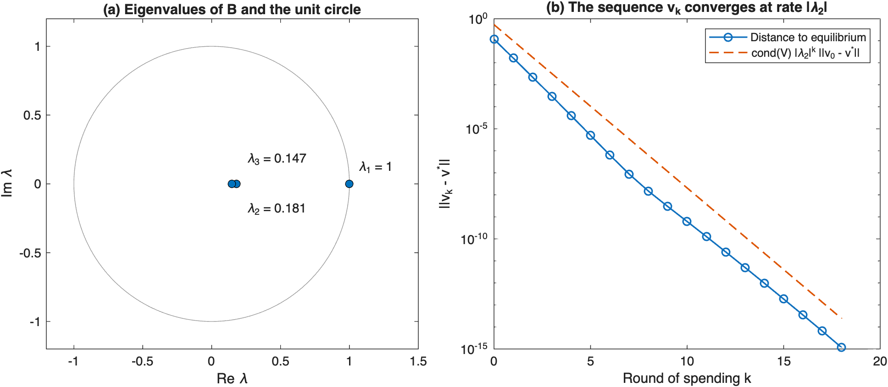
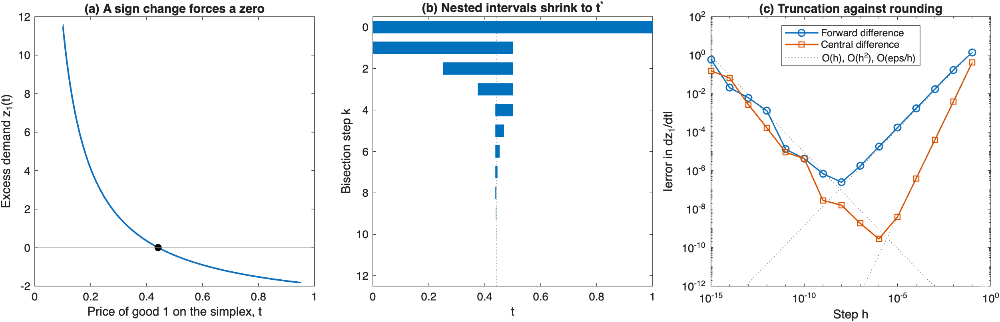
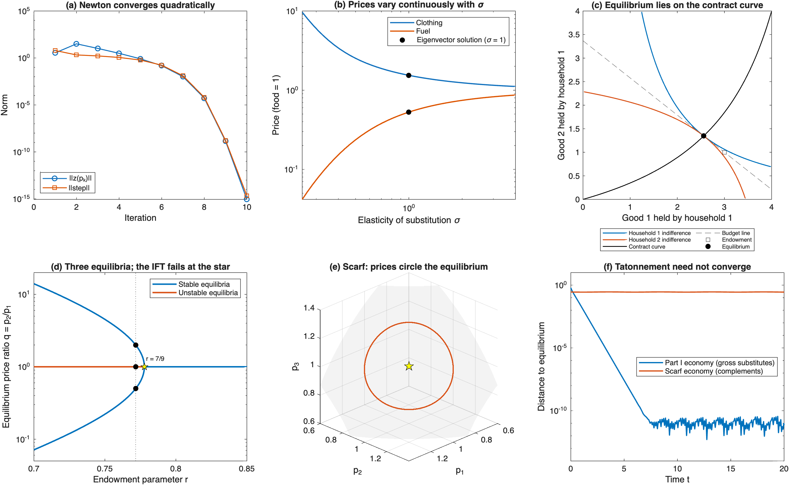

# Prices as Eigenvectors

Computing, proving and stress-testing general equilibrium in MATLAB.

I built this project while taking MATH E-23a, Linear Algebra and Real Analysis I,
at Harvard Extension School in fall 2026, to apply the course's mathematics to
economics. It takes the central object of microeconomic theory, a Walrasian
equilibrium (a set of prices at which every market clears), and asks:

- Does it exist?
- Is it unique?
- How do we compute it?
- How does it respond to shocks?

Each result is proved or cited in [`docs/proofs.md`](docs/proofs.md),
implemented in MATLAB and checked by a unit test. This is an independent
project, not a course assignment.

## The key idea

With Cobb-Douglas consumers, market clearing is linear:

$$v = Bv, \qquad B_{jk} = \sum_i \frac{a_{ij}\ e_{ik}}{\omega_k},$$

where $v_j = p_j\omega_j$ is the market value of good $j$. Every column of $B$
sums to one, so the equilibrium values are an eigenvector with eigenvalue 1,
the same mathematics as PageRank. Prices are then an eigenvector of the similar
matrix $\mathrm{diag}(\omega)^{-1}B\ \mathrm{diag}(\omega)$.

## Structure

| Part | Course modules | Result |
| --- | --- | --- |
| [I. Linear algebra](part1LinearAlgebra.m) | 0-4 | Prices are exactly $(1,\ 507/329,\ 174/329)$. Uniqueness fails when the economy splits into two islands. Power iteration converges at rate $\lvert\lambda_2\rvert = 0.181$. |
| [II. Real analysis](part2Analysis.m) | 5-9 | Existence from the intermediate value theorem, with bisection as nested intervals. Finite differences show that floating point is not $\mathbb{R}$. |
| [III. Calculus in $\mathbb{R}^n$](part3Calculus.m) | 7-13 | Newton's method, Lagrange multipliers, implicit-function comparative statics, an economy with three equilibria, and Scarf's never-ending price cycles. |

## Syllabus map

| Module | Topic | Where it is used | Test |
| --- | --- | --- | --- |
| 0 | Sets, functions, fields | Row reduction stays in $\mathbb{Q}$, so prices are rational | `testEigenvectorClearsMarkets` |
| 1 | Linear transformations | Incomes $m = Ep$ and the map $v \mapsto Bv$ | `testEigenvectorClearsMarkets` |
| 2 | Geometry of $\mathbb{R}^n$ | Walras' law $z(p) \perp p$; Scarf's Jacobian $v \mapsto \frac14(1,1,1)\times v$ | `testWalrasLawAndHomogeneity` |
| 3 | Row reduction, basis | `rref(B - I)` has rank $n-1$; two islands give a two-dimensional null space | `testReducibleEconomyHasNoUniquePrices` |
| 4 | Eigenvalues | Equilibrium as an eigenvector; the error shrinks by $\lvert\lambda_2\rvert$ per round | `testPowerIterationBound` |
| 5 | Sequences | The best finite-difference step, since floating point is not $\mathbb{R}$ | `testFiniteDifferenceStepTradeOff` |
| 6 | Cauchy sequences | Bisection and power iteration produce Cauchy sequences | `testBisectionMatchesClosedForm` |
| 7 | Continuity | The intermediate value theorem; prices are continuous in $\sigma$ | `testNewtonAgreesWithEigenvector` |
| 8 | Limits of functions | Excess demand at the boundary of the price simplex; CES tends to Cobb-Douglas as $\sigma \to 1$ | `testCesDemandTendsToCobbDouglas` |
| 9-10 | Derivatives in $\mathbb{R}^n$ | Analytic Jacobian; Euler's identity $Jp = 0$; Newton in log prices | `testJacobianIdentities` |
| 11 | Implicit functions, manifolds | Comparative statics of a transfer; the point where the equilibrium set stops being a manifold | `testImplicitFunctionTheorem` |
| 12 | Lagrange multipliers | CES demand from $\nabla u = \lambda p$, with $\lambda = 1/P$ | `testLagrangeConditionAtDemand` |
| 13 | Taylor series, ODEs | Newton converges quadratically; tatonnement $\dot p = z(p)$ solved with `ode45` | `testScarfSmallCyclePeriod` |

## Results

| Result | Value | Independent check |
| --- | --- | --- |
| Cobb-Douglas prices (food = 1) | 1.541033, 0.528875 | exactly 507/329 and 174/329 |
| Two-good equilibrium by bisection | $t^{\ast} = 0.44117647058824$ | closed form 15/34 |
| CES prices, $\sigma = 0.5$ | 2.528345, 0.236092 | Newton step ratio $\approx 0.40$ (quadratic convergence) |
| Food transfer, $dp/d\tau$ | (0.6766, 0.0286) | re-solved equilibria |
| Textbook economy | $q = 1/2,\ 1,\ 2$ | index sum $+1$ |
| Scarf cycle period | 14.5104 | $8\pi/\sqrt3$ |





With many goods and general preferences, existence needs a fixed-point theorem
beyond this course. Here it is proved for two goods and for Cobb-Douglas economies.

## Running it

MATLAB R2021a or newer, no toolboxes.

```matlab
main                          % Parts I-III; writes figures and tables to results/
results = runtests('tests')   % 16 unit tests
```

## Layout

```
main.m                 runs Parts I-III
part1LinearAlgebra.m   eigenvectors, rank, power iteration
part2Analysis.m        existence, bisection, finite differences
part3Calculus.m        Newton, implicit functions, Lagrange, stability
src/                   economy, demand, Jacobian and solvers
tests/                 unit tests
docs/proofs.md         the eleven results behind the code
results/               figures and tables written by main.m
```

## References

- Hubbard & Hubbard (2015). *Vector Calculus, Linear Algebra, and Differential Forms*, 5th ed.
- Ross (2013). *Elementary Analysis*, 2nd ed.
- Mas-Colell, Whinston & Green (1995). *Microeconomic Theory*, Ch. 15-17.
- Arrow & Debreu (1954). *Econometrica* 22(3), 265-290.
- Arrow, Block & Hurwicz (1959). *Econometrica* 27(1), 82-109.
- Scarf (1960). *International Economic Review* 1(3), 157-172.
